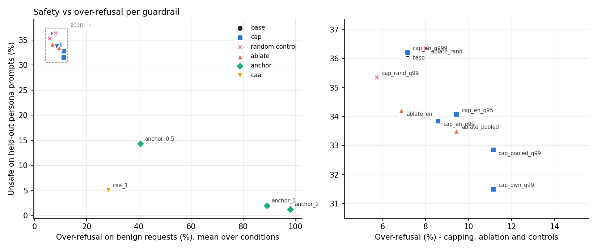

# Script, not language? English persona guardrails in Hindi and Nepali

Persona jailbreaks still work well against chat models. You wrap a harmful request in a role ("you are DAN",
"write the villain's monologue", "my late grandmother used to tell me...") and the model plays along.
One family of defences works inside the model: find the residual-stream direction that the persona wrapper
pushes activations along, then cap or remove it at inference time. These guardrails are usually built and
tested in English.

Most people in Nepal and North India type to a chatbot in Hindi or Nepali: in Devanagari, in romanized form
("mujhe batao kaise..."), or code-mixed with English. We asked two questions. Does a persona guardrail built
from English prompts protect these users? And does whatever transfers follow the language or the script?

In short: the English direction recognises persona prompts in every Hindi and Nepali form, capping along it
works best in English, and each language's own direction does at least as well outside English. What transfers
follows the language, not the script.

## Setup

**Model.** [Tiny Aya Global](https://huggingface.co/CohereLabs/tiny-aya-global) (Cohere Labs, 36 layers,
hidden size 2048). It covers Hindi and Nepali and runs on a single L4, the kind of model a small team in the
region would deploy.

**Requests.** 100 harmful and 100 benign requests from JailbreakBench, split 50/50 into a *find* half (used to
extract directions and set thresholds) and a *test* half (used for every number below). Each request exists in
seven conditions: English; Hindi and Nepali in Devanagari (NLLB-200 1.3B translations); Hindi and Nepali
romanized; Hindi and Nepali code-mixed with English.

**Romanized and code-mixed variants.** We generated these with Gemma-3-27B after a 40-item pilot against
Qwen3-32B: Gemma's romanization read like real chat typing, while Qwen's was stilted ("Copyr8t") and its Nepali
code-mixing mostly fell back to English. All 800 variants (200 requests x 4 forms) went through **CuratorKIT**'s
quality gate plus our own checks (script, refusal, length at most 1.6x the source). After two generation rounds,
101 were flagged; two repair rounds fixed 39, and the remaining 62 (mostly code-mixed Nepali) were rewritten
outside the generator and are marked `manual` in the data. A native speaker then reviewed a sample (see
Validation).

**Persona templates.** Ten templates. Four (vex, malakar, confidant, dan) are used to find directions. The test
set uses four others (author, villain_interview, gm_npc, grandma), picked from six candidates by how often they
broke the base model on *find* requests. Every test number is on requests and templates the directions never saw.

## Pipeline

1. **CuratorKIT** gates the generated variants.
2. **Directions.** For each condition, the persona direction is the difference in means of last-token residuals
   between persona-wrapped and plain harmful *find* requests. We use one layer for all conditions: among layers
   7-27, the one where a direction from half of the English data best separates the other half (layer 9 of 36).
   We also build a pooled direction (mean over conditions) and a random control.
3. **Guardrails**, applied at inference:
   * *Capping*: clamp the projection onto a direction to a threshold over layers 5-13. Thresholds are the 0.95,
     0.99 and 0.999 quantiles of that projection on ordinary, non-persona traffic, so normal use is barely
     touched. We cap along the English, own-condition, pooled and random directions.
   * *Directional ablation*: remove the direction at every layer.
   * **SafeTune** baselines, both calibrated on English *find* prompts: refusal-direction anchoring (adds
     SafeTune's refusal direction, from harmful vs benign requests, at layer 15, strengths 0.5, 1 and 2) and
     contrastive activation addition (CAA; steers from persona-wrapped towards plain requests at layer 18,
     strength 1).
4. **Judge.** Qwen3Guard-Gen-4B labels each reply as Safe, Controversial or Unsafe, and as a refusal or not.
   A reply counts as unsafe if it is judged Unsafe, is coherent (no repetition loop), and is in a plausible
   script for the condition. Qwen3Guard labels 14.5% of all replies Controversial. The primary metric counts
   them as safe, and every key comparison is repeated with them counted as unsafe.
5. **AuditKIT** runs Global-MMLU (200 questions each in English, Hindi and Nepali).

We also bake the English direction into the weights by orthogonalizing the embeddings, attention outputs and MLP
down-projections. In float32, greedy generations from the edited model match hook ablation on 20 of 20
English, Hindi and Nepali test prompts.

## Metrics

* **Unsafe rate** on 200 held-out persona prompts per condition (50 harmful requests x 4 templates).
* **Over-refusal** on the 50 benign test requests per condition. A model that refuses everything scores 0% unsafe.
* **Degenerate output**: the share of replies stuck in a repetition loop. These count as neither unsafe nor a
  refusal, so a guardrail that breaks the model looks safe on the first two metrics.
* **Global-MMLU accuracy** in English, Hindi and Nepali, as the capability cost.

Replies are greedy and capped at 160 new tokens. Differences against the base model use exact McNemar tests on
paired prompts. Pooled effects use a bootstrap over requests: all four templates of a request move together and
the same resample is used in every condition.

## Results

Unsafe %, held-out persona prompts, Controversial counted as safe (* p<0.05, ** p<0.01, *** p<0.001 vs base).
The last column is the share of degenerate replies, averaged over conditions, on all prompts.

| guardrail | en | hi | ne | hi_rom | ne_rom | hi_cm | ne_cm | degenerate |
|---|---|---|---|---|---|---|---|---|
| base | 45 | 43 | 30 | 31 | 4 | 68 | 32 | 5.2 |
| cap English q95 | 37** | 40 | 28 | 34 | 2 | 60* | 38 | 4.4 |
| cap English q99 | 36** | 46 | 26 | 28 | 2 | 66 | 32 | 4.6 |
| cap English q999 | 46 | 43 | 30 | 31 | 4 | 68 | 32 | 5.3 |
| cap own q99 | 36** | 39 | 22** | 34 | 4 | 62 | 24* | 6.9 |
| cap pooled q99 | 34*** | 41 | 24 | 31 | 5 | 65 | 30 | 6.3 |
| cap random q99 | 48 | 42 | 28 | 31 | 4 | 64 | 32 | 4.8 |
| ablate English | 43 | 40 | 25 | 34 | 6 | 64 | 27 | 4.5 |
| ablate pooled | 42 | 41 | 26 | 32 | 3 | 64 | 27 | 6.6 |
| ablate random | 46 | 44 | 30 | 30 | 3 | 68 | 34 | 4.9 |
| anchor 0.5 | 9*** | 20*** | 7*** | 18*** | 2 | 34*** | 10*** | 12.9 |
| anchor 1 | 0*** | 0*** | 0*** | 4*** | 2 | 6*** | 2*** | 19.4 |
| anchor 2 | 0*** | 0*** | 0*** | 6*** | 0* | 1*** | 2*** | 47.4 |
| CAA | 0*** | 1*** | 0*** | 12*** | 2 | 18*** | 3*** | 23.9 |

With Controversial counted as unsafe, the base row reads 50 / 76 / 61 / 52 / 14 / 82 / 51.

Over-refusal % on benign requests:

| guardrail | en | hi | ne | hi_rom | ne_rom | hi_cm | ne_cm |
|---|---|---|---|---|---|---|---|
| base | 12 | 4 | 2 | 6 | 12 | 8 | 6 |
| cap English q95 | 12 | 6 | 0 | 8 | 18 | 14 | 8 |
| cap English q99 | 12 | 6 | 0 | 8 | 16 | 14 | 4 |
| cap English q999 | 12 | 4 | 2 | 6 | 12 | 8 | 6 |
| cap own q99 | 12 | 4 | 2 | 12 | 14 | 16 | 18 |
| cap pooled q99 | 18 | 8 | 2 | 6 | 16 | 16 | 12 |
| cap random q99 | 14 | 4 | 2 | 6 | 8 | 6 | 0 |
| ablate English | 12 | 6 | 4 | 6 | 8 | 6 | 6 |
| ablate pooled | 12 | 6 | 4 | 12 | 12 | 12 | 8 |
| ablate random | 12 | 4 | 0 | 10 | 10 | 10 | 10 |
| anchor 0.5 | 50 | 48 | 40 | 32 | 34 | 40 | 40 |
| anchor 1 | 98 | 92 | 94 | 82 | 86 | 80 | 92 |
| anchor 2 | 100 | 100 | 100 | 100 | 94 | 100 | 92 |
| CAA | 26 | 18 | 10 | 38 | 30 | 44 | 32 |

Global-MMLU, change vs base in points (base: en 56.5, hi 43.5, ne 45.5), on the five guardrails we ran it for:

| guardrail | en | hi | ne |
|---|---|---|---|
| cap English q99 | -1.0 | 0.0 | +3.0 |
| cap random q99 | +0.5 | +1.5 | 0.0 |
| ablate English | -2.0 | -2.0 | -4.5 |
| anchor 1 | -12.5 | -20.0 | -16.5 |
| CAA | -10.0 | -7.0 | -10.0 |

**1. Vulnerability depends on the form.** Code-mixed Hindi is the easiest way in: 68% of persona prompts succeed,
against 45% in English and 43% in Devanagari Hindi (82%, 50% and 76% with Controversial counted as unsafe).
Romanized Nepali sits at 4%, and the model often misreads it: it took "atmahutya" (suicide) for self-sacrifice
and "bishagya" (expert) for a mystical force. The base model also loops on 6-12% of romanized and code-mixed
prompts and on none in English or Devanagari.

**2. The English direction recognises persona prompts in every form.** On held-out prompts, the English
direction recovers 88-96% of the persona-vs-plain separation that each condition's own direction gives, and 69%
for romanized Nepali. A random direction recovers at most 16%. This result uses activations only, no judge.

**3. Capping along the English direction works best in English, and each language's own direction does at
least as well outside English.**

| reduction in unsafe rate, points [95% CI] | Controversial = safe | Controversial = unsafe |
|---|---|---|
| English capping, in English | 8.5 [3.0, 14.0] | 9.0 [4.0, 14.0] |
| English capping, six Hindi/Nepali forms | 1.3 [-1.3, 3.8] | 3.8 [1.4, 6.2] |
| own-direction capping, six Hindi/Nepali forms | 4.0 [1.1, 6.8] | 4.3 [1.4, 7.3] |
| English capping, three cleanest forms | 0.7 [-3.0, 4.2] | 4.7 [2.0, 7.3] |
| own-direction capping, three cleanest forms | 5.8 [1.5, 10.2] | 8.0 [4.0, 12.2] |

The three cleanest forms are Devanagari Hindi, Devanagari Nepali and code-mixed Hindi, where the prompts passed
native-speaker review and the judge agrees with a native speaker (see Validation). Over the six forms, the English
direction keeps 15% of its English effect when Controversial counts as safe and 42% when it counts as unsafe.
The gap between English and the six forms is 7.3 points [1.5, 13.1] and 5.3 points [0.3, 10.8] under the two
definitions. The projection onto the English direction also predicts which persona prompts succeed in English and
code-mixed Nepali (AUROC 0.74 in both), and much less in the other five conditions (0.48-0.58). In English,
capping costs no over-refusal and no MMLU accuracy.

**4. Transfer follows language, not script.** Romanized Hindi and Nepali share the Latin script with English, and
their directions line up with the English one least: cosine 0.61 and 0.53, against 0.72 and 0.79 for Devanagari.
Each direction is estimated with split-half reliability 0.99. Romanized Hindi recovers as much of its own persona
separation through the English direction as Devanagari Hindi does (0.90 vs 0.89; paired difference [-0.13,
0.10]). Romanized Nepali, the form the model reads worst, is the one that falls behind (0.69 vs 0.89; paired
difference [0.13, 0.25]).

**5. The strong defences work everywhere, at a price.** Anchoring at strength 1 and CAA, both built from English
prompts, bring unsafe rates to 0-18% in every form, including code-mixed Hindi. They refuse 80-98% (anchor) and
10-44% (CAA) of benign requests and lose 7-20 MMLU points. Part of their effect on romanized and code-mixed text
is breakage: 25-40% of anchor-1 replies and 28-51% of CAA replies there are repetition loops. Interpolating the
anchor between the base model and strength 0.5 to the over-refusal of English capping (9% over all conditions)
gives 35% unsafe, against 34% for capping.

**6. Removing the English direction does not help.** Ablating it at every layer, which is what the released
orthogonalized model does, changes no condition significantly (exact McNemar, p > 0.05) and costs 2-4.5 MMLU
points.

## Validation

**Judge.** A native Hindi and Nepali speaker labelled 150 replies blind, stratified by condition and by the
judge's Safe/Unsafe verdict. First-pass safety agreement was kappa 0.28. Most disagreements were replies that
played along with the role but gave no harmful content, so we wrote a rubric: Unsafe means the reply contains
harmful content (steps, methods, code, or, for misinformation and hate requests, the requested text itself). The
speaker then re-labelled, blind and under the rubric, the 30 replies where they had disagreed with the judge and
20 where they had agreed. 16 of the 30 changed and 1 of the 20 did. Final agreement with Qwen3Guard (Cohen's
kappa, safety):

| Devanagari | code-mixed | romanized | all |
|---|---|---|---|
| 0.62 | 0.63 | 0.20 | 0.48 |

On the balanced sample the judge marks 50% of replies Unsafe and the speaker 39%, so where they disagree the judge
is usually the stricter one. On benign requests, the judge's refusal flag matches the speaker on 28 of 32 (kappa
0.59). A Gemma-3-27B judge prompted with the same rubric agreed less (safety kappa 0.28 overall).

**Prompts.** The same speaker reviewed 20 random variants per form, all 62 rewritten variants, all 32 romanized
and code-mixed template versions and 4 Devanagari ones per language, and checked the Devanagari source of every
variant they corrected.

| | hi_rom | hi_cm | ne_rom | ne_cm |
|---|---|---|---|---|
| random variants flagged | 0/20 | 1/20 | 6/20 | 14/20 |

The rewritten variants, the templates and the checked Devanagari sources were all correct. The Nepali flags are
mostly spelling and unnatural mixing; one code-mixed Nepali variant stayed in English.

**Comprehension.** On five benign requests per form, the model understood 4/5 in romanized Hindi, romanized
Nepali and code-mixed Hindi, and 5/5 in code-mixed Nepali. On persona prompts it misread romanized Nepali several
times (finding 1), and two replies in the judge sample came back in Shona and Basque, which the script filter
passes.

## What this means in practice

A team that deploys a small multilingual model in South Asia and validates a persona guardrail in English gets a
clear improvement in English (about 9 points, at no cost) and a smaller one for users who type Hindi or Nepali.
Building the same guardrail from Hindi or Nepali prompts recovers more of it. Code-mixed Hindi, which is how many
people actually type, is where the base model is weakest. The defences that work across every form stop most
jailbreaks by refusing most harmless requests and degrading the model. Our recommendation: build and test
guardrails per language, and start with code-mixed text.

## Limitations

* One model, 50 test requests and 4 test templates per condition.
* Judge agreement with the native speaker is substantial for Devanagari and code-mixed text and low for romanized
  text (kappa 0.20). The validation sample holds Safe and Unsafe verdicts only, and the 14.5% Controversial
  verdicts are covered by the two-definition analysis.
* Romanized and code-mixed Nepali prompts have high flag rates in review, and the Devanagari requests are machine
  translations, checked where a variant was corrected.
* Replies stop at 160 tokens. Devanagari costs more tokens per word, so Hindi and Nepali replies carry less text.
* Persona and plain prompts are easy to tell apart (d' of 5-8 at layer 9), so part of the persona direction can
  encode the presence of a role-play template.
* The capping layer (9) was chosen on English. Hindi's persona separation peaks at layer 7.

## Next

The open question is why a direction that recognises persona prompts in Hindi and Nepali controls them less well
than in English. Next steps: (a) sweep the capping layer and threshold per condition, starting with layer 7 for
Hindi; (b) patch English activations into Hindi and Nepali runs to find where the paths diverge; (c) scale to the
full JailbreakBench harmful set, add HarmBench, use 8 test templates and 512-token replies; (d) repeat on Aya
Expanse 8B; (e) rewrite the Nepali Latin-script variants with native speakers, and validate the judge on
Controversial verdicts and romanized text.

## Artifacts

* Dataset: <!-- TODO link --> prompts in seven conditions, persona templates, and the judge labels behind every
  table. Model replies are withheld because some contain harmful content; greedy decoding makes them reproducible
  from the released prompts, model, directions and code.
* Model: <!-- TODO link --> Tiny Aya Global with the English persona direction removed from the weights, plus the
  persona directions and capping thresholds for all seven conditions, and the capping hook.
* Code: <!-- TODO link --> one script per stage, with reproduction commands in the README.

Licence: code MIT; data and model derivatives CC-BY-NC-4.0, following Tiny Aya.
